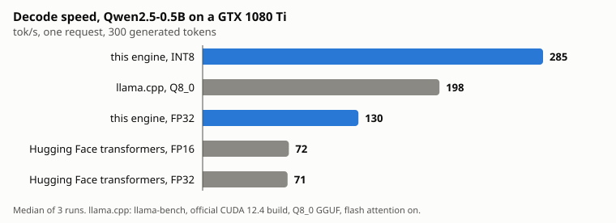
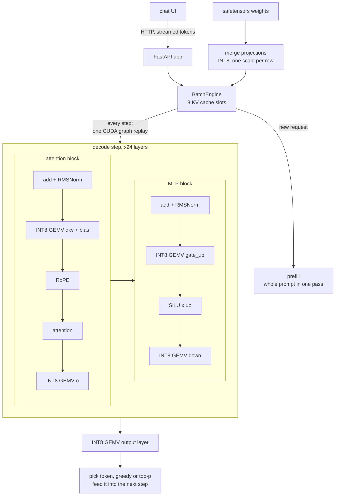
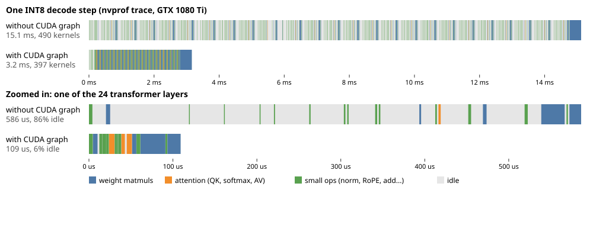
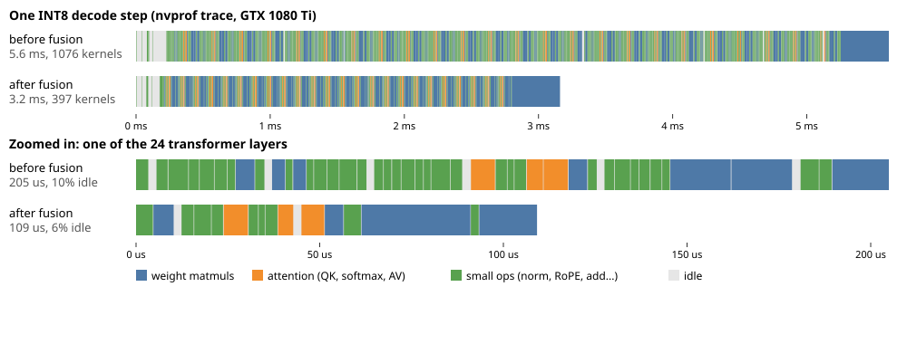

# Qwen LLM Inference

An inference engine for **Qwen2.5-0.5B-Instruct** written from scratch: it loads the raw `safetensors` weights and runs the model in PyTorch plus custom CUDA kernels, without `transformers` in the model path. Every component is checked against Hugging Face.

On a GTX 1080 Ti it decodes **285 tok/s with INT8 weights, 1.4x llama.cpp and 4x Hugging Face transformers**, and serves concurrent requests with continuous batching at up to 521 tok/s combined.



**What's inside**

- Llama-style architecture by hand: RoPE, grouped-query attention, SwiGLU, RMSNorm, KV cache, greedy and top-p sampling
- Per-row INT8 quantization: 4x smaller model, under 1% perplexity cost
- CUDA kernels: an INT8 matrix-vector kernel (batch 1 to 8), fused RMSNorm + residual add, RoPE and SiLU
- CUDA graphs: each token is one graph replay instead of ~400 kernel launches
- Profiling with nvprof and a bandwidth model
- FastAPI server with token streaming, a chat UI and continuous batching

## Architecture



- **Grouped-query attention:** 2 KV heads, 14 query heads.
- **RoPE:** rotate-half, cos/sin tables precomputed from `rope_theta`, absolute positions during cached decoding.
- **Qwen specifics:** biases on the q, k, v projections, and tied input/output embeddings.

## Correctness

| Check | Method | Result |
|---|---|---|
| Logits | vs Hugging Face, FP32 | max abs. diff 6.1e-05 (gate < 1e-3) |
| Layer components | forward hooks on HF, layer 0 | RMSNorm, attention, MLP all < 1e-4 |
| KV cache | 300-token greedy decode, cached vs uncached | identical tokens |
| INT8 kernel | every projection, batch 1 to 8, with and without bias, vs dequantize + matmul | max rel. error 2.4e-07 |
| Fused RMSNorm, RoPE, SiLU | vs the PyTorch versions | RMSNorm 1.2e-07, RoPE and SiLU bit-identical |
| All custom kernels | 200-token INT8 greedy decode vs plain PyTorch | identical tokens |
| CUDA graph decode | 300-token greedy and 100-token seeded sampling, FP32 and INT8, vs cached | identical tokens |
| Continuous batching | 6 greedy requests on 4 slots vs `greedy_cached`, FP32 and INT8 | identical tokens |

## How it got fast

GTX 1080 Ti (484 GB/s), Windows 11, PyTorch cu126, CUDA 12.6. 300 generated tokens, one request. Rows are from different sessions and can differ from the chart by a few percent. Raw runs in [`benchmark/RESULTS.md`](benchmark/RESULTS.md).

| Step | tok/s |
|---|---|
| PyTorch FP32 with KV cache | 53.8 |
| + CUDA graph | 108.8 |
| + INT8 weights and kernel | 161.5 |
| + INT8 output layer | 195.7 |
| + merged projections and fused kernels | **293.4** |

### 1. KV cache

Without a cache, each new token reruns the forward pass over the whole sequence, so generating n tokens is O(n²). The cache stores every layer's keys and values, so each step computes q, k, v for the new token only and attends over the stored history, O(n) total. Greedy decoding on an M4 MacBook Air CPU:

| Generated tokens | No cache (tok/s) | KV cache (tok/s) | Speedup |
|---|---|---|---|
| 30 | 7.87 | 23.4 | 3.0x |
| 150 | 6.21 | 27.4 | 4.4x |
| 300 | 4.07 | 26.3 | 6.4x |

### 2. INT8 quantization

Each weight row gets one FP32 scale, `scale = max|row| / 127`, and stores `round(w / scale)`. Norms and biases stay FP32.

| | FP32 | INT8 | Change |
|---|---|---|---|
| Quantized tensors | 1884.31 MB | 472.82 MB | 3.99x smaller |
| Whole model | 1884.59 MB | 473.09 MB | 3.98x smaller |
| Perplexity, 300 tokens | 12.8151 | 12.8968 | +0.64% |
| Perplexity, 1024 tokens | 14.4113 | 14.5206 | +0.76% |
| Perplexity, 2048 tokens | 14.8940 | 14.9675 | +0.49% |

- Perplexity is measured on *Pride and Prejudice* (Project Gutenberg 1342) from Chapter 1. `benchmark_quantized` reads the file's first 300 tokens, which are the Gutenberg license header, so it reports a lower 7.1541 FP32 / 7.1538 INT8. On a GPU it also runs the text one token at a time through the INT8 kernel and matches to 4 decimals.
- **The embedding table** (151936 x 896, ~519 MB in FP32) is over a quarter of the model. Qwen ties it to the output layer, so one INT8 copy serves both: a lookup scales the token's INT8 row, and the output layer runs through the INT8 kernel. Quantizing it took the model from 2.19x to 3.98x smaller. Its rounding error counts twice, but perplexity moved under 0.1 points (it was +0.71 / +0.73 / +0.43% with an FP32 embedding).
- On CPU, and for prompt processing on GPU, weights are dequantized to FP32 right before `torch.matmul`. GPU decode uses the kernel below.

### 3. INT8 GEMV kernel

Decode is memory-bound: one GEMV per projection. [`int8_gemv_ext.cu`](cuda/int8_gemv_ext.cu) reads the INT8 weights directly and applies the scale once per row, `y[i] = scale[i] * sum_j W[i][j] * x[j]`, moving 4x fewer bytes than FP32.

| µs per call (before projections were merged) | gate/up 4864x896 | down 896x4864 | q/o 896x896 |
|---|---|---|---|
| v1: one block per row | 73.37 | 37.81 | 14.16 |
| v2: one warp per row, shuffle reduction | 31.19 | 38.08 | 7.12 |
| v3: `char4`/`float4` vector loads (final) | 18.76 | 17.50 | 6.21 |
| cuBLAS FP32 | 54.98 | 54.67 | 12.00 |
| **v3 speedup over cuBLAS** | **2.99x** | **3.46x** | **1.78x** |

q/o gains least because ~6 µs is close to the ~5 µs cost of launching an empty kernel. Tried and dropped on top of v3: 16-byte weight loads (slower, the matching `x` reads scatter), staging `x` in shared memory (mixed), `#pragma unroll` (no change).

**Batched kernel.** Each warp loads a weight row once and multiplies it against up to 8 input vectors, with the batch size as a template parameter so the partial sums stay in registers. Results are bit-identical alone or batched. The kernel also adds an optional bias. µs per call on the merged shapes ([`bench_int8_batch`](benchmark/bench_int8_batch.py)):

| Shape | Batch | INT8 kernel | Dequantize + matmul | cuBLAS FP32 |
|---|---|---|---|---|
| gate_up 9728x896 | 1 | 28.71 | 436.24 | 97.57 |
| gate_up | 8 | 112.96 | 493.58 | 156.30 |
| down 896x4864 | 1 | 15.91 | 231.00 | 52.55 |
| down | 8 | 51.98 | 282.59 | 103.99 |
| qkv 1152x896 | 1 | 9.31 | 64.15 | 15.80 |
| qkv | 8 | 20.53 | 74.49 | 24.97 |

The lead over FP32 shrinks at batch 8, where the kernel does 8x the math per weight byte. It is ~4x faster than dequantizing, which batched INT8 used before.

### 4. CUDA graphs

A 3x faster kernel barely changed end-to-end speed: INT8 was still slower than FP32. Each token launched ~1100 small kernels and the GPU sat idle waiting on Python.

[`stream_graph`](src/generate.py) prefills normally, then records one [`decode_step`](src/model.py) as a CUDA graph and replays it per token. Graphs need fixed shapes and addresses, so the decode step:

- writes K/V in place into a preallocated cache and masks unwritten slots (the regular path uses `torch.cat`);
- keeps the RoPE tables and the position tensor on the GPU;
- picks the token (`argmax` or top-p) outside the graph.

| 300 tokens, median of 3 | Cached decode (tok/s) | + CUDA graph (tok/s) | Graph speedup |
|---|---|---|---|
| FP32, before fusion | 53.8 | 108.8 | 2.0x |
| FP32 | 68.3 | 136.0 | 2.0x |
| INT8, before fusion | 53.3 | 189.8 | 3.6x |
| INT8 | 80.0 | **293.4** | 3.7x |

Timings include prefill and graph capture. Dequantizing on every call instead of using the kernel ran at 30 tok/s.

| INT8 decode step, nvprof trace | Step time | GPU busy | GPU idle | Kernels |
|---|---|---|---|---|
| Without graph, before fusion | 21.58 ms | 4.30 ms | 80% | 1119 |
| With graph, before fusion | 5.47 ms | 4.86 ms | 11% | 1076 |
| Without graph, after fusion | 15.09 ms | | 84% | 490 |
| With graph, after fusion | 3.16 ms | | 11% | 397 |

Traced steps are slower than untraced ones. The idle time left with the graph is between steps: picking the token, `.item()` and launching the next replay. Current code:



### 5. Profiling and kernel fusion

Quantizing the output layer cut the bytes read per token 1.82x (~904 MB to ~496 MB) but sped decoding up only 1.21x.

**Bandwidth model.** [`bench_bandwidth`](benchmark/bench_bandwidth.py) compares step time against bytes read over bandwidth, using a device copy (~340 GB/s) as the reference instead of the 484 GB/s spec. It replays one step's graph 200 times, then profiles it and groups every kernel (median of 3, 512-token KV cache, before fusion):

| | FP32 | INT8 |
|---|---|---|
| Bytes read per step | 1989 MB | 509 MB |
| Time per step | 8.97 ms | 4.95 ms |
| Achieved bandwidth | 222 GB/s (63% of copy) | 103 GB/s (29% of copy) |
| Step time at copy speed | 5.62 ms | 1.44 ms |
| Kernels per step | 997 | 1072 |

| INT8 step, before fusion | Kernels | Time | Share |
|---|---|---|---|
| Small ops (RMSNorm, RoPE, residual adds, SiLU, bias) | 831 | 2.22 ms | 46% |
| Weight matmuls (INT8 kernel) | 169 | 1.92 ms | 39% |
| Attention (QK, softmax, AV) | 72 | 0.74 ms | 15% |

- **Small ops were the biggest cost.** ~2.7 µs each, about the launch cost of any kernel, and the same 2.2 ms in FP32 and INT8. RMSNorm alone was ~294 kernels (square, mean, add eps, sqrt, divide, scale, for 49 norms) and RoPE ~240.
- **The INT8 kernel reached 73% of copy speed**, cuBLAS FP32 91%.
- At copy speed for its weight reads alone, INT8 would run near 700 tok/s instead of 202.

**Trace.** [`profile_trace`](benchmark/profile_trace.py) decodes 20 INT8 tokens under nvprof and [`analyze_trace`](benchmark/analyze_trace.py) splits the trace into steps (each ends with the 18,992-block output layer kernel), prints per-projection numbers and draws the charts. Nsight Compute doesn't support Pascal and nvprof's counters need admin on Windows, so bandwidth comes from timing and known byte counts.

| Projection | Before fusion: µs / GB/s | After: µs / GB/s |
|---|---|---|
| q, o (896x896) | 5.2 / 155 to 159 | o: 4.96 / 163 |
| k, v (128x896) | 3.4 / 34 to 35 | merged into qkv (1152x896): 5.50 / 189 |
| gate, up (4864x896) | 16.6 to 17.1 / 256 to 264 | merged into gate_up (9728x896): 28.00 / 313 |
| down (896x4864) | 15.7 / 279 | 14.58 / 301 |
| output layer (151936x896) | 386.5 / 354 | 359.18 / 381 |

Before merging, k and v launched only 16 blocks on 28 SMs, and q, k, v and o took 26% of the matmul time for 4% of the bytes. The output layer beats the copy reference because a copy reads and writes every byte, a matmul mostly reads.

**Fusion.** The fixes, in [`fused_ops.cu`](cuda/fused_ops.cu) and [`loader.py`](src/loader.py):

- **Merged projections:** q, k, v into one 1152x896 matrix and gate, up into one 9728x896 matrix at load time (per-row quantization leaves the INT8 weights unchanged). 4 matmuls per layer instead of 7, with the q/k/v bias added inside the INT8 kernel.
- **Fused residual add + RMSNorm:** one block per row, warp-shuffle reduction, also writes `x + residual` for the next layer. The layer loop in [`model.py`](src/model.py) carries the sum and its normalized copy, so every residual add joins the next norm. One kernel instead of up to 8.
- **Fused RoPE:** rotates q and k in place in the qkv output. `__fmul_rn`/`__fadd_rn` prevent FMA contraction, keeping it bit-identical to PyTorch.
- **Fused SiLU x up** on the gate_up output.

Each op in [`layers.py`](src/layers.py) falls back to PyTorch on CPU or a failed build. Perplexity is unchanged to 4 decimals. Each stage via `bench_bandwidth`, three versions in alternating rounds, median of 3:

| INT8 decode step | Kernels | Time | Steps/s |
|---|---|---|---|
| Before | 1072 | 5.177 ms | 193 |
| Merged projections, bias in kernel | 878 | 4.747 ms | 211 |
| + fused RMSNorm, RoPE, SiLU | **393** | **3.360 ms** | **298** |

| Group | Kernels | Before | After |
|---|---|---|---|
| Weight matmuls | 169 → 97 | 2.05 ms (72% of copy) | 1.79 ms (82% of copy) |
| Small ops | 831 → 224 | 2.26 ms | 0.73 ms |
| Attention | 72 → 72 | 0.76 ms | 0.79 ms |

FP32 went from 9.431 to 7.607 ms per step. In the trace, one layer dropped from 44 kernels in 205 µs to 16 in 109 µs, and weight matmuls are now over half of each step.



### 6. Against the baselines

[`bench_baselines`](benchmark/bench_baselines.py), same chat prompt, 300 greedy tokens, one request, median of 3:

| Setup | tok/s |
|---|---|
| This engine, INT8 | **285.1** |
| llama.cpp b12686, Q8_0 (official CUDA 12.4 build, Qwen's GGUF, flash attention on) | 198.4 |
| This engine, FP32 | 130.4 |
| Hugging Face transformers, FP16 | 72.2 |
| Hugging Face transformers, FP32 | 71.2 |

- Hugging Face is the same speed in FP16 and FP32: at ~14 ms per token it is launch-bound, not memory-bound.
- llama.cpp is more general and faster at processing prompts. Its Q8_0 format stores an FP16 scale per 32 weights and an untied output matrix.

## Serving and continuous batching

A FastAPI app streams tokens to a browser chat UI. On a GPU, requests go through [`BatchEngine`](src/batching.py), with INT8 weights when the kernels build and FP32 otherwise. On CPU, a lock runs them one at a time.

- A background thread owns the GPU. Each request gets a slot in a preallocated KV cache (8 slots, 2048 tokens each), is prefilled alone, then joins the batch at the next step. Finished or disconnected requests free their slot immediately.
- Each step is one CUDA graph replay of the same batched `decode_step` as the single-request path, captured at startup for 1, 2, 4 and 8 requests.
- Each request keeps its own temperature and top-p.

Combined throughput, 100 greedy tokens per request, median of 3 ([`bench_batching`](benchmark/bench_batching.py)):

| Weights | Requests | One at a time (tok/s) | Batched (tok/s) | Speedup |
|---|---|---|---|---|
| FP32 | 1 | 135.6 | 116.3 | 0.86x |
| FP32 | 4 | 136.9 | 369.2 | 2.72x |
| FP32 | 8 | 134.7 | 475.2 | 3.55x |
| INT8 | 1 | 281.5 | 195.5 | 0.70x |
| INT8 | 4 | 267.1 | 416.3 | 1.56x |
| INT8 | 8 | 263.9 | **520.5** | 1.98x |

INT8 gains less from batching since each step already reads 4x fewer bytes, but stays ahead of FP32 at every load (1.68x for one request, 1.10x for eight). A lone request is 31% slower than the single-request path because it attends over its full 2048-token slot.

**Load test**, all clients fired at once with `asyncio.gather` ([`bench_app`](benchmark/bench_app.py)), FP32, up to 100 tokens each, median of 3:

| Clients | One at a time: p50 / p95 / req/s | Batched: p50 / p95 / req/s |
|---|---|---|
| 1 | 0.77 s / 0.77 s / 1.30 | 1.53 s / 1.53 s / 0.65 |
| 4 | 2.50 s / 2.68 s / 1.49 | 2.00 s / 2.00 s / 2.00 |
| 8 | 5.01 s / 6.77 s / 1.18 | **2.90 s / 2.91 s / 2.75** |

Serving INT8 (before the output layer was quantized): 1.22, 1.81 and 2.78 s p50 at 1, 4 and 8 clients (2.87 req/s at 8). Single-client latency varies between runs (0.47 to 1.54 s) because requests sample at temperature 0.7 and stop at end of sequence.

On CPU (50-token replies), one request at a time:

| Clients | p50 | p95 | Req/s |
|---|---|---|---|
| 1 | 10.28 s | 10.28 s | 0.10 |
| 4 | 58.13 s | 77.89 s | 0.05 |
| 8 | 66.44 s | 118.90 s | 0.07 |

## What's left

- **Attention** is 24% of a step: cuBLAS batched matmuls and a separate softmax per layer over the whole preallocated cache. A fused decode attention kernel would also fix the slow lone request in the batch engine.
- **o and down** use only 112 blocks on 28 SMs (163 to 301 GB/s).
- **The gap between steps** (~0.3 to 0.5 ms per token) from picking the token on the CPU with `.item()`.
- **Speculative decoding** with prompt lookup.

## Usage

```bash
git clone https://github.com/BharatJassal/Qwen_LLM_Inference.git
cd Qwen_LLM_Inference
python -m venv .venv
source .venv/bin/activate          # Windows: .venv\Scripts\Activate.ps1
pip install torch --index-url https://download.pytorch.org/whl/cu126   # NVIDIA GPU only
pip install -r requirements.txt
python download_model.py

uvicorn src.app:app --port 8000
# or: docker build -t qwen-inference . && docker run -p 8000:8000 qwen-inference
```

```python
from transformers import AutoTokenizer
from src.loader import load_weights
from src.config import ModelConfig
from src.quantize import quantize_model
from src.generate import greedy_cached, greedy_graph

tok = AutoTokenizer.from_pretrained("model")
cfg = ModelConfig.from_json("model/config.json")
text = tok.apply_chat_template([{"role": "user", "content": "Write a story about the ocean."}],
                               tokenize=False, add_generation_prompt=True)
ids = tok(text, return_tensors="pt").input_ids

# CPU
out = greedy_cached(ids, load_weights("model/model.safetensors"), cfg, max_new_tokens=50)
# NVIDIA GPU: INT8 weights and CUDA graph decoding
weights = quantize_model(load_weights("model/model.safetensors", "cuda"))
out = greedy_graph(ids.to("cuda"), weights, cfg, max_new_tokens=50)
print(tok.decode(out[0]))
```

**CUDA kernels** (`cuda/bindings.cpp`, `int8_gemv_ext.cu`, `fused_ops.cu`) compile on first use and need the CUDA Toolkit 12.6, a C++ compiler and `ninja`. If the build fails, they fall back to PyTorch with a warning: INT8 dequantizes, fused ops use PyTorch, and the app serves FP32. On Windows, run from a VS developer shell:

```powershell
& "${env:ProgramFiles(x86)}\Microsoft Visual Studio\2022\BuildTools\Common7\Tools\Launch-VsDevShell.ps1" -Arch amd64 -HostArch amd64 -SkipAutomaticLocation
.venv\Scripts\Activate.ps1
```

Run any of these with `python -m <name>`:

| Test | Checks |
|---|---|
| `tests.test_HF` | RMSNorm, attention, MLP and logits vs Hugging Face |
| `tests.test_generate` | naive greedy generation end to end, prints the output |
| `tests.test_gate2` | cached and uncached decoding give identical tokens |
| `tests.test_sample` | sampling at temperature 0 equals greedy |
| `tests.test_int8_kernel` | INT8 kernel vs dequantize + matmul on every shape, batch 1 to 8, with bias; a batched row matches the same row alone bit for bit; all custom kernels decode the same tokens as plain PyTorch |
| `tests.test_fused_ops` | RMSNorm, RoPE, SiLU kernels vs PyTorch; bad shapes rejected |
| `tests.test_ext_fallback` | fakes a failed build, INT8 layers and fused ops still work |
| `tests.test_graph` | graph decoding (greedy and seeded sampling, FP32 and INT8) matches the cached path |
| `tests.test_batching` | 6 requests on 4 slots match `greedy_cached`; over-long requests rejected; cancelled requests free their slots |

| Benchmark | Measures |
|---|---|
| `benchmark.benchmark` | 30, 150, 300 tokens, cached vs uncached |
| `benchmark.benchmark_quantized` | FP32 vs INT8 memory and perplexity |
| `benchmark.bench_int8_speed` | FP32 and INT8 decode, with and without CUDA graphs |
| `benchmark.bench_int8_batch` | kernel at batch 1 to 8 vs dequantize and cuBLAS |
| `benchmark.bench_batching` | batched vs one at a time throughput |
| `benchmark.bench_app` | server load test, p50 / p95 latency |
| `benchmark.bench_bandwidth` | achieved bandwidth per step and time per kernel group |
| `benchmark.bench_baselines [llama-bench.exe model.gguf]` | Hugging Face, llama.cpp and this engine, draws `baselines.svg` |
| `benchmark.profile_trace` + `analyze_trace` | nvprof timeline, per-projection table, `timeline.svg` and `fusion.svg` |

**Kernel timeline with nvprof** (ships with CUDA 12.6, supports Pascal). nvprof must launch the base interpreter, so the venv goes through `PYTHONPATH`:

```powershell
$env:PATH = "$env:CUDA_PATH\extras\CUPTI\lib64;$env:PATH"
$env:PYTHONPATH = "$PWD;$PWD\.venv\Lib\site-packages"
$py = (python -c "import sys; print(sys._base_executable)")
foreach ($m in "cached", "graph") { nvprof --profile-from-start off --print-gpu-trace --csv -u us --log-file benchmark/trace_$m.csv $py -m benchmark.profile_trace $m }
python -m benchmark.analyze_trace                              # timeline.svg
python -m benchmark.analyze_trace path/to/old/trace_graph.csv  # also fusion.svg, old vs current
```

On Volta or newer, or as administrator, Nsight Systems records the same run: `nsys profile -t cuda,nvtx --cuda-graph-trace=node --capture-range=cudaProfilerApi -o benchmark/decode python -m benchmark.profile_trace graph` (untested here, nsys needs admin on this machine).

**Standalone kernel harness**: [`cuda/int8_gemv.cu`](cuda/int8_gemv.cu) checks the kernel against a CPU reference and times it against cuBLAS (`sm_61` is the GTX 1080 Ti; change it for your GPU):

```powershell
cd cuda
nvcc -O3 -arch=sm_61 -lcublas -o int8_gemv.exe int8_gemv.cu
.\int8_gemv.exe
```

## References

- Qwen2.5 technical report and model card
- The tokenizer is Hugging Face's `AutoTokenizer`; `transformers` is otherwise only used as the reference in tests and baselines.

## License

MIT License © 2026 Bharat Jassal
Contact: jassal.bharat18@gmail.com
